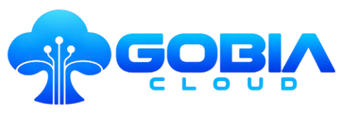

<p align="center">
  
</p>

<p align="center">
  <a href="https://github.com/darkzmaj/Gobiadactyl-Panel/releases/latest"></a>
  <a href="https://github.com/darkzmaj/Gobiadactyl-Panel/actions/workflows/gobia-ci.yaml"></a>
  <a href="LICENSE.md"></a>
</p>

# Gobiadactyl Panel

Gobiadactyl Panel is the game server control panel behind [Gobia Cloud](https://gobia.cloud). It is a fork of
[Pterodactyl Panel](https://github.com/pterodactyl/panel) 2.0, built as extensions on Pterodactyl's extension SDK wherever
possible, so upstream improvements keep flowing in.

> **Fork notice.** Gobiadactyl is not affiliated with or endorsed by the Pterodactyl project. Pterodactyl® is a
> registered trademark of Dane Everitt and contributors. All credit for the underlying panel goes to the Pterodactyl
> team; see [Credits](#credits).

## What Gobiadactyl adds

* **Gobia look and branding** as a theme extension (`gobia-theme`): dark, light and system, with admin settings for the logo,
  footer, sidebar card and console prompt.
* **File workspace** (`gobia-files`): a Monaco editor with tabs, workspace search and replace, change detection with compare,
  dual server editing, and drag and drop transfers between two servers (verified byte for byte). A per person Legacy mode
  keeps the classic file pages with the same editor.
* **Instance list** with views (All, You, Other), personal categories and live power, CPU, memory and storage indicators.
* **Access in one place**: share instances with other people from the account page, with presets built on Pterodactyl's
  own permissions.
* **Templates and provisioning** (`gobia-templates`).
* **Resource protector**: server creation and resource changes keep a safety reserve on every node; the admin overview shows
  what is still safe to allocate.
* **Offsite backups** (`gobia-backups`) streamed encrypted to an SFTP storage box.
* **Signed one click updates**: Admin, Updates installs only releases signed with the Gobia release key, after a preflight,
  with a database backup and automatic rollback.

## Install

Gobiadactyl runs where Pterodactyl 2.0 runs: PHP 8.3 or 8.4, MariaDB 10.5+ or MySQL 8, Redis (recommended), and Pterodactyl
Wings on the game nodes.

* **Container (recommended):** build an image from a signed release with [`deploy/docker`](docs/gobia-docker.md).
* **Release package:** download `gobia-panel-<version>.tar.gz` and `release.json` from
  [Releases](https://github.com/darkzmaj/Gobiadactyl-Panel/releases), check the signature, and install like a Pterodactyl
  panel. Later updates go through Admin, Updates ([how updates work](docs/gobia-updates.md)).
* **Coming from Gobia 1.x:** see [the 1.x import](docs/gobia-upgrade-from-1x.md); 1.x cannot update in place.

Release signing key (Ed25519, public): `U/2XlTOgdzsn2lebHDxjkh7HFSNqmYLkm+Hj+3MdVJI=`

## Documentation

| Topic | Where |
| --- | --- |
| Updates, release signatures, rollback | [docs/gobia-updates.md](docs/gobia-updates.md) |
| Container image and compose file | [docs/gobia-docker.md](docs/gobia-docker.md) |
| Customisation (branding, theme settings) | [docs/gobia-customisation.md](docs/gobia-customisation.md) |
| Offsite backups | [docs/gobia-backups.md](docs/gobia-backups.md) |
| What Gobiadactyl changes in Pterodactyl's own files | [docs/gobia-core-patches.md](docs/gobia-core-patches.md) |
| Everything else (panel, Wings, eggs) | [Pterodactyl documentation](https://pterodactyl.io) |

## Development

```bash
composer install && npm ci
cp .env.example .env && php artisan key:generate && php artisan migrate --seed
npm run dev        # Vite
php artisan serve  # backend
```

Checks: `npm run tsc`, `npm run lint`, `npm test`, `composer test`. See [CONTRIBUTING.md](CONTRIBUTING.md).

## Branches

* `main`: the current panel (Pterodactyl 2.0 based).
* `gobia-1.x-preserved` and tag `gobia-1.15-final`: the earlier Gobia panel on Pterodactyl 1.x, kept for reference.

## Credits

Gobiadactyl Panel is built on [Pterodactyl Panel](https://github.com/pterodactyl/panel) by Dane Everitt and the Pterodactyl
contributors, released under the MIT licence. File icons come from
[Material Icon Theme](https://github.com/material-extensions/vscode-material-icon-theme) (MIT, see
[docs/gobia-file-icons.md](docs/gobia-file-icons.md)).

## Licence

MIT, like Pterodactyl. See [LICENSE.md](LICENSE.md); the original Pterodactyl copyright notice is kept there.
